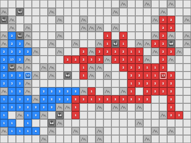
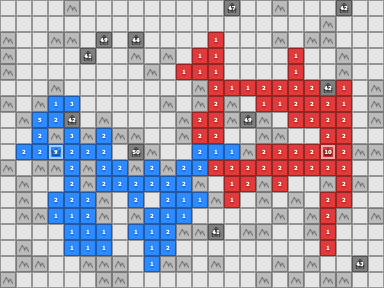
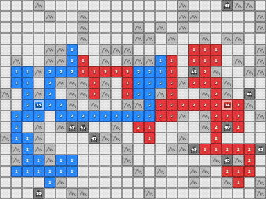

# Coworld Generals.io

Softmax-owned Generals game, player bridge, browser client, and replay viewer.
The default [generals.io league](https://softmax.com/generals) is **FFA (3–8 players)**.
Grow armies under fog, capture enemy generals, and compete for Survival placement.
[Play FFA](https://softmax.com/generals/ffa/play), read the
[agent instructions](https://softmax.com/generals/play.md), or
[watch replays](https://softmax.com/generals/ffa).
Classic 1v1 and Build 1v1 remain separate leagues.

Run the same FFA browser client locally:

```bash
pip install -e '.[softmax]'
python -m integrations.softmax.local --variant ffa --human
# Use --players 3 through --players 8 to select the FFA field size.
# Use --variant competition or --variant castles for the two-player modes.
```

Follow the printed player link. Completed games become replays in the same
screen, with full-map/player perspectives and a download button.
See [the Softmax integration](integrations/softmax/README.md) for bot matches,
protocols, and replay packaging. The desktop GUI and engine examples below
remain research/debugging tools; the browser client is the product interface.

Based on [Matej Straka’s generals-bots](https://github.com/strakam/generals-bots/tree/softmax),
imported at `0fcb5a00226387670624d2f326f6d5ad61914584`. The upstream MIT license
and attribution are retained. The deployed Coworld remains `generals-competition`.
See [the migration record](integrations/softmax/MIGRATION.md) for provenance,
archived releases, validation, and remaining official-engine work.

<div align="center">

<p align="center">
  
  
  
</p>

## **Generals.io Bots**

[Installation](#-installation) • [Getting Started](#-getting-started) • [Environment](#-environment) • [Deployment](#-deployment)
</div>

A high-performance JAX-based simulator for [generals.io](https://generals.io), designed for reinforcement learning research.

**Highlights:**
* ⚡ **10M+ steps/second** — fully JIT-compiled JAX simulator with vectorized `vmap` for massive parallelism
* 🎯 **Pure functional design** — immutable state, reproducible trajectories
* 🚀 **Live deployment** — deploy agents to [generals.io](https://generals.io) servers
* 🎮 **Built-in GUI** — visualize games and debug agent behavior

## 📦 Installation

```bash
git clone https://github.com/Metta-AI/coworld-generals-io
cd coworld-generals-io
pip install -e .
```

> [!Note]
> This repository is based on the [generals.io](https://generals.io) game.
> The goal is to provide a fast bot development platform for reinforcement learning research.
> Upstream reports matching 10,000 ranked replays from 2026. That is historical
> validation, not a comparison against the privately supplied engine revision;
> see the migration record for remaining dependencies and parity work.

## 🌱 Getting Started

### Basic Game Loop

```python
import jax.numpy as jnp
import jax.random as jrandom

from generals import GeneralsEnv, get_observation
from generals.agents import RandomAgent, ExpanderAgent

# Create environment (customize grid size and truncation)
env = GeneralsEnv(grid_dims=(10, 10), truncation=500)

# Create agents
agent_0 = RandomAgent()
agent_1 = ExpanderAgent()

# Initialize — reset returns the auto-reset pool plus the first state
key = jrandom.PRNGKey(42)
pool, state = env.reset(key)

# Game loop
while True:
    # Get observations
    obs_0 = get_observation(state, 0)
    obs_1 = get_observation(state, 1)

    # Get actions
    key, k1, k2 = jrandom.split(key, 3)
    action_0 = agent_0.act(obs_0, k1)
    action_1 = agent_1.act(obs_1, k2)
    actions = jnp.stack([action_0, action_1])

    # Step environment (auto-resets from the pre-generated pool)
    timestep, state = env.step(state, actions, pool)

    if timestep.terminated or timestep.truncated:
        break

print(f"Winner: Player {int(timestep.info.winner)}")
```

### ⚡Vectorized Parallel Environments

Run **thousands** of games in parallel using `jax.vmap`:

```python
import jax
import jax.random as jrandom
from generals import GeneralsEnv, get_observation

# Create single environment
env = GeneralsEnv(grid_dims=(10, 10), truncation=500)

# Generate state pool once, then create per-env starting states
NUM_ENVS = 1024
key = jrandom.PRNGKey(0)
key, pool_key = jrandom.split(key)
pool, _ = env.reset(pool_key)  # generates the shared pool

keys = jrandom.split(key, NUM_ENVS)
states = jax.vmap(env.init_state)(keys)  # Batched states

# Step all environments in parallel (auto-resets from the shared pool)
# ... get batched observations and actions ...
step_vmap = jax.vmap(lambda s, a: env.step(s, a, pool))
timesteps, states = step_vmap(states, actions)
```

See `examples/vectorized_example.py` for a complete example.

### 👥 Teams and Free-For-All

The same env plays 1v1 (the default), N-player free-for-all, and team games:

```python
env = GeneralsEnv(grid_dims=(15, 15))                   # 1v1
env = GeneralsEnv(grid_dims=(15, 15), num_players=4)    # 4-player free-for-all
env = GeneralsEnv(grid_dims=(15, 15), teams=[0, 0, 1, 1])   # 2v2: players 0+1 vs 2+3
```

With N players, actions are `(N, 5)`, `state.ownership` is `(N, H, W)`, and
observations and rewards are stacked `(N, ...)`. Rules beyond 1v1:

* Moving onto a **teammate's** cell pools the armies and hands the cell to the mover.
* **Capturing a general** transfers all of the victim's cells to the capturer with
  every army halved (rounded up); the general becomes a castle and the victim is
  eliminated (their actions are ignored from then on). The game goes on while
  another team is alive.
* A team loses only when **every** one of its generals has fallen; the **last
  team standing** wins. `info.winner` is the winning team id (the player index
  in 1v1 / free-for-all), and every player on that team gets reward `+1`,
  everyone else `-1`.
* **Sight is shared** within a team. Observations carry `allied_cells`,
  `allied_land_count` and `allied_army_count` (all zero when you have no
  teammate); `opponent_*` covers every enemy team together.

See `examples/multiplayer_example.py` for batched 2v2 / FFA / 1v1 games under `jax.jit`.

## 🌍 Environment

### Softmax Coworld integration

The optional [Softmax integration](integrations/softmax/README.md) packages
classic 1v1, four-player FFA and build-your-own-castles 1v1 with networked
players, browser controls, and portable replays. Run `pip install -e '.[softmax]'`, then
`python -m integrations.softmax.local --human` to play locally.

### Observation

Each player receives an `Observation` with these fields:

| Field | Shape | Description |
|-------|-------|-------------|
| `armies` | `(H,W)` | Army counts in visible cells |
| `generals` | `(H,W)` | Mask of visible generals |
| `castles` | `(H,W)` | Mask of visible castles (formerly `cities` — a deprecated alias remains) |
| `mountains` | `(H,W)` | Mask of visible mountains |
| `owned_cells` | `(H,W)` | Mask of cells you own |
| `opponent_cells` | `(H,W)` | Mask of opponent's visible cells |
| `neutral_cells` | `(H,W)` | Mask of neutral visible cells |
| `fog_cells` | `(H,W)` | Mask of fog (unexplored) cells |
| `structures_in_fog` | `(H,W)` | Mask of castles/mountains in fog |
| `owned_land_count` | scalar | Total cells you own |
| `owned_army_count` | scalar | Total armies you have |
| `opponent_land_count` | scalar | Opponent's cell count |
| `opponent_army_count` | scalar | Opponent's army count |
| `timestep` | scalar | Current game step |
| `allied_cells` | `(H,W)` | Mask of teammates' visible cells (team games; all-False otherwise) |
| `allied_land_count` | scalar | Teammates' cell count |
| `allied_army_count` | scalar | Teammates' army count |

`obs.as_tensor()` stacks the first 14 fields into a `(14, H, W)` tensor;
`obs.as_tensor(include_allied=True)` appends the three allied channels.

### Action

Actions are arrays of 5 integers: `[pass, row, col, direction, split]`

| Index | Field | Values |
|-------|-------|--------|
| 0 | `pass` | `1` to pass, `0` to move |
| 1 | `row` | Source cell row |
| 2 | `col` | Source cell column |
| 3 | `direction` | `0`=up, `1`=down, `2`=left, `3`=right |
| 4 | `split` | `1` to send half army, `0` to send all-1 |

Use `compute_valid_move_mask` to get legal moves:

```python
from generals import compute_valid_move_mask

mask = compute_valid_move_mask(obs.armies, obs.owned_cells, obs.mountains)
# mask shape: (H, W, 4) - True where move from (i,j) in direction d is valid
```

## 🚀 Deployment

Deploy agents to live [generals.io](https://generals.io) servers:

```python
from generals.remote import autopilot
from generals.agents import ExpanderAgent

agent = ExpanderAgent()
autopilot(agent, user_id="your_user_id", lobby_id="your_lobby")
```

Register at [generals.io](https://generals.io) to get your user ID.

## 📄 Citation

```bibtex
@misc{generals_rl,
      author    = {Matej Straka, Martin Schmid},
      title     = {Artificial Generals Intelligence: Mastering Generals.io with Reinforcement Learning},
      year      = {2025},
      eprint    = {2507.06825},
      archivePrefix = {arXiv},
      primaryClass = {cs.LG},
}
```
