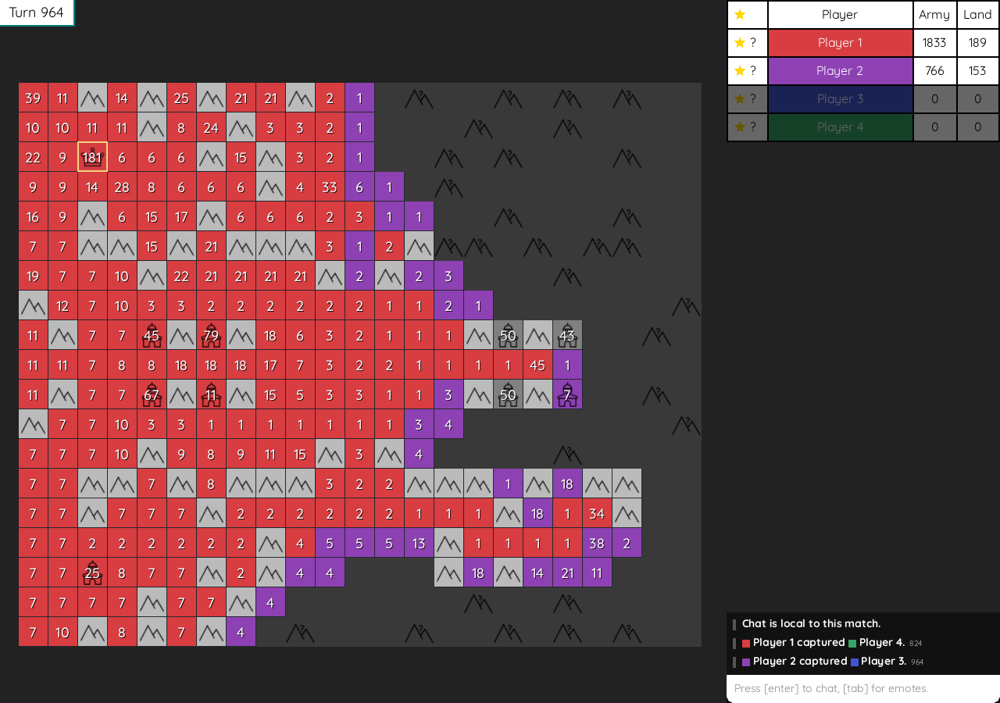

# Polyworld Generals

A complete local Generals strategy game in Nim with Silky and Polyworld's
default Tractor buttons. Play a two-to-ten-player free-for-all against
scripted opponents. Capture every enemy general to win.



## Run

Requires Nim 2.2.10 or newer and native OpenGL support.

With the usual sibling Polyworld and Nim library checkouts:

```sh
nim c -d:release -o:out/generals src/generals.nim
./out/generals
```

For a fresh checkout, fetch the pinned dependencies first. Access to the
private Metta-AI repositories is required.

```sh
sh tools/fetch_deps.sh
nim c -d:release -o:out/generals src/generals.nim
./out/generals
```

All graphics, UI images, and fonts are bundled in `assets`. No sibling art
checkout is required. Use `POLYWORLD_DEPS` to choose another dependency root.

On macOS, `sh tools/build_app.sh` creates a self-contained application at
`out/Polyworld Generals.app` that can be opened from Finder.

## Play

- Select your red land, then use arrow keys, WASD, or adjacent tile clicks.
- A move sends all armies except one. Hold Shift to send half.
- Right-click clears queued orders.
- Space pauses. The toolbar also changes speed and restarts the game.
- Mountains block movement. Cities and generals produce an army each second.
- Every owned tile produces an army every 25 seconds.
- Capturing a general transfers its land and half its remaining armies.
- Simultaneous mutual captures trade generals and territory.
- Fog reveals your territory and its eight neighboring cells.

A match lasts at most 4,000 half-second ticks. If several players survive,
the match is a draw. Bots use visible information, and every seed produces
repeatable simulation results.

## Check

```sh
nim check src/generals.nim
nim r tests/tests.nim
nim c -d:release -d:headless -o:out/generals-sim src/generals.nim
./out/generals-sim --headless --seed=1 --players=4
```

To capture a deterministic game frame:

```sh
./out/generals --play --seed=1 --at=200 --screenshot=out/game.png
```

See `docs/UPSTREAM.md` for source credits and the basic ruleset's scope.
See `docs/REFERENCE.md` for the Python reference comparison and its scope.
