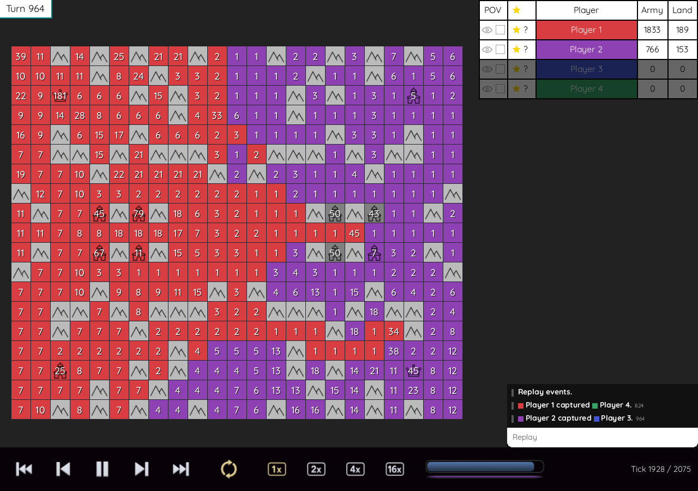

# Replays



Generals uses the shared `POLYWORLDREPLAY` file envelope used by GotA and
Galcon. Its Flatty payload uses Polyworld's `ActionTape`, like GotA. It
stores the initial configuration, the map generator version and initial
map hash, the public player roster and MMR values, submitted moves, public chat, and one state hash for
every completed simulation tick.

Playback regenerates the board from the recorded configuration and runs
the same simulation with the recorded moves. Bots do not run during
playback. Every resulting state is checked against the recorded hash.
Board snapshots are not stored in the replay file.

Record a complete bot match:

```sh
./out/generals --headless --seed=7 --record=out/match.replay
```

Open the recording in the graphical viewer:

```sh
./out/generals --replay=out/match.replay
```

Start the viewer at a particular simulation tick:

```sh
./out/generals --replay=out/match.replay --at=1000
```

Verify every recorded tick without opening a window:

```sh
./out/generals --headless --replay=out/match.replay
```

The headless executable `out/generals-sim` supports recording and
verification with the same options. A mismatch, malformed file, or
unsupported replay version exits with a descriptive error and nonzero
status. The replay configuration determines the board and match rules.
`--record` and `--replay` cannot be combined. Replay playback also rejects
bot and human controller flags. Split forms such as `--replay PATH` work
alongside the existing `--replay=PATH` form.

At the end of a local match, **Watch Replay** opens its in-memory action
tape. Replays start at the beginning, playing automatically with looping
enabled. `--play=false` starts paused, and `--speed N` selects the initial
speed. Use the standard Polyworld ribbon to play, pause, step, scrub,
change speed, or toggle looping. Space toggles playback, Left and Right
step one tick, and Home and End seek to the endpoints. `--at` starts a
file replay at the requested tick while preserving the selected pause state.

The replay-only POV checkboxes combine the selected players' visibility.
With none checked, the complete board is visible. Eliminated players are
unchecked. Eye buttons independently orient the map around a player's
original home; clicking the selected eye restores the default orientation.
The event log is rebuilt from the simulation as playback advances or seeks.
Public chat is recorded at its displayed tick and restored when seeking or
looping. Up to 16,384 public messages fit in a recording; later messages
still reach the UI and mailboxes without stopping simulation recording.
Direct messages, BASIC source, and bot file paths are not saved.

The current game reads and writes game version 5 only. Earlier replay
versions belong to the archived game builds that created them. There is
no conversion or older-format reader in this build.

Version 5 retains the compact encoding introduced in version 4. It stores
ordinary commands as one 32-bit word, instead of eight
32-bit fields. The action tape contains a Flatty sequence of these words:

| Bits | Value |
| --- | --- |
| 0 through 11 | Source tile index. |
| 12 through 13 | Direction: up, down, left, right. |
| 14 | Send half the army. |
| 15 through 18 | Player index, from 0 through 9. |
| 19 through 31 | Tick delta from the preceding recorded command. |

The target is derived from the source, direction, and board width.
Commands in the same tick have a zero delta. Passes are omitted. A normal
move costs exactly four bytes, including its tick and player. Every tick
still has an eight-byte state hash for deterministic verification.

The reserved word `0xffffffff` introduces an extended command containing
the absolute tick, player, flags, source, target, row, column, and
direction as eight 32-bit words. This 36-byte form preserves raw reference
commands, rejected commands, unusual fields, and gaps over 8,191 ticks
without changing their meaning. Ordinary valid army moves use the compact
form. Decoding bounds the expanded action count before allocating it and
rejects noncanonical encodings, invalid geometry, and truncated records.

The configuration stores the full unsigned 64-bit seed. Map generator version
3 uses SplitMix64, and this build rejects older game and map versions.
The same seed, dimensions, player count, and generator version always
reconstruct the same starting board for this game build. The public
roster retains names, MMR, and the bot identity-query flag. See
[BASIC bots](BOTS.md) for player settings and the mailbox interface.

Graphical `--record` saves the latest local match on completion and again
when the window closes, including an unfinished match. The default viewer
keeps the current match tape in memory without writing a file.

New matches allow up to 4,000 half-second ticks, or 2,000 displayed
turns, and end earlier when only one player remains. Each replay retains
its recorded turn limit. Use `--ticks COUNT` or `--turns=COUNT` to choose
a different limit. `--seconds N` and `--minutes N` convert at two ticks
per second. See [command-line flags](CLI.md) for the full shared interface.
